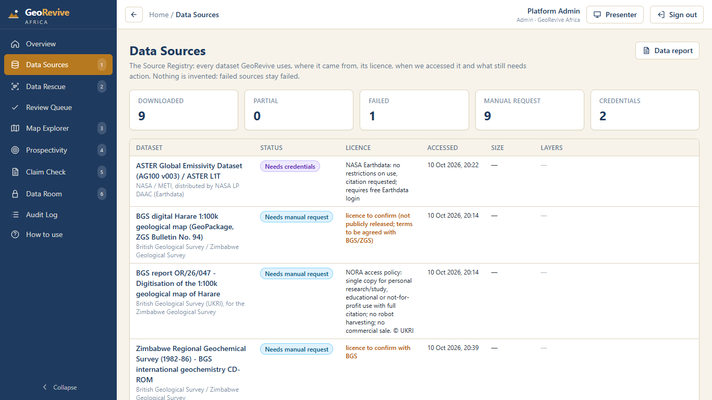
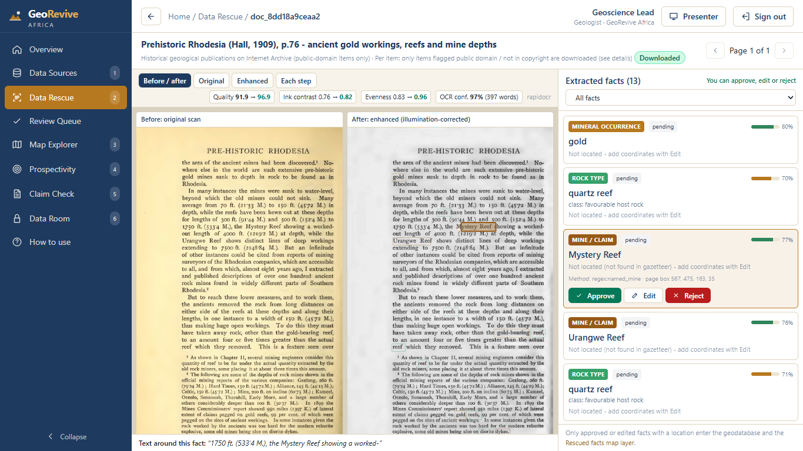
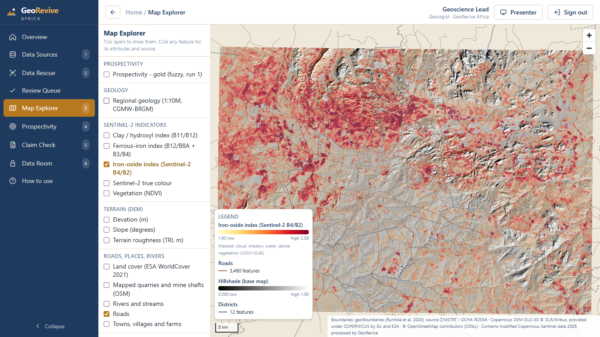
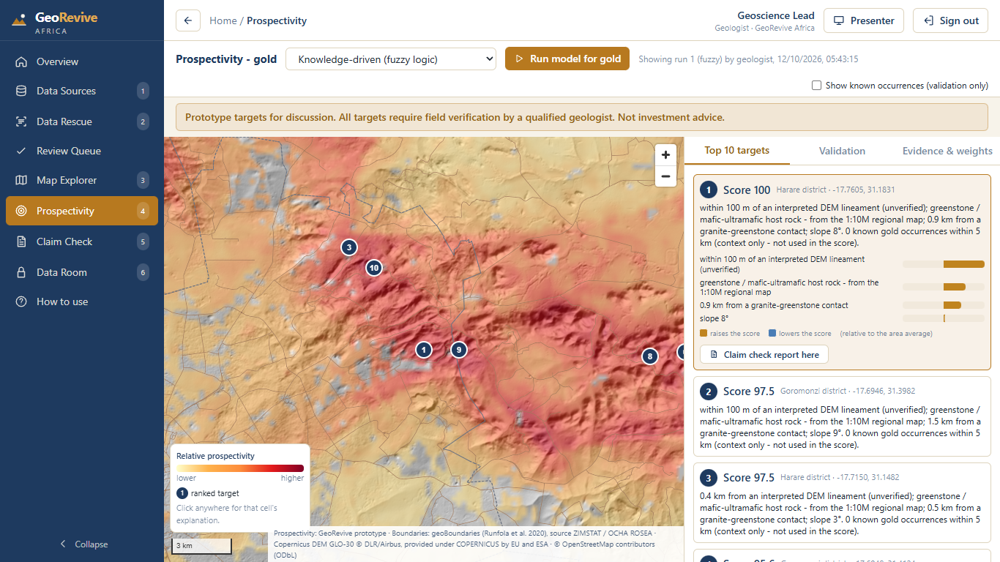
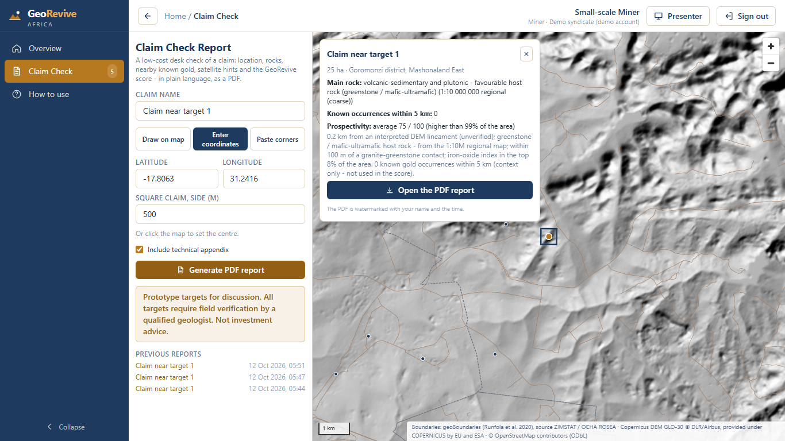
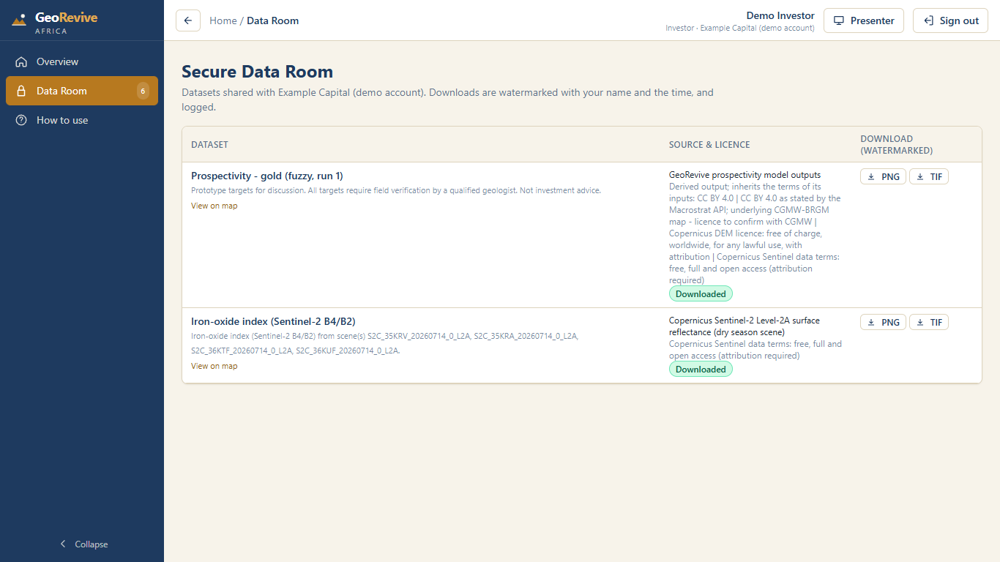

# GeoRevive Africa

**An AI platform that turns Africa's paper-based geological records into ranked, explainable exploration targets.**

Prototype for the timbuktoo MineTech Hub / UNDP Pan-African Mine-Tech Pre-Incubation Programme 2026. The challenge is *Innovative Technologies for Smarter, Safer and Sustainable Mineral Exploration in Africa*.

> **Prototype targets for discussion. All targets require field verification by a qualified geologist. Not investment advice.**

---

## The problem
Decades of geological knowledge in Africa sit on paper: survey bulletins, maps, mine reports and assay sheets. They are faded, stained, scattered across archives, and out of reach of modern exploration. Small-scale miners, who produce much of Zimbabwe's gold, rarely have affordable, trustworthy geological advice. Investors, for their part, have little reason to trust targets they cannot trace back to evidence.

## Our solution
GeoRevive has three parts:

1. **Data rescue.** It cleans scans (stains, skew, uneven lighting), reads them with OCR, and extracts rock units, mineral occurrences, assays, mines, farms and locations. Every fact links back to its exact place on the original page, and **a geologist approves each fact** before it enters the geodatabase.
2. **Explainable prospectivity.** It combines the rescued facts with free satellite imagery (Sentinel-2), elevation data and open maps. It then ranks gold targets with a knowledge-driven model a geologist can edit, plus data-driven models checked by spatial cross-validation. **Every target says in plain words why it scored highly.**
3. **Claim reports and a secure data room.** It produces low-cost, plain-language claim-check PDFs for small-scale miners. Investors get access-controlled sharing, watermarked downloads and a full audit trail.

Every dataset is recorded in a **Source Registry** (URL, licence, access date, SHA-256 checksums, status). Nothing is invented: data we could not obtain is listed with instructions for how to request it.

Pilot area: the Zimbabwe Geological Survey's **Harare 1:100 000 sheet** (Bulletin No. 94), including part of the Harare greenstone belt. The area is configurable in `config.yaml`.

---

## Prototype status

**Works now (tested end to end, offline after the first data download):**

| Part | Status |
|---|---|
| Source Registry and Data Report | ✅ 21 sources tried. Open data downloaded with checksums; blocked or restricted sources recorded with instructions ([Data Report](reports/DATA_SOURCES.md)) |
| Data rescue | ✅ Enhancement (stain reduction, deskew, denoise, illumination correction, CLAHE, binarisation); OCR with word boxes; rule-based extraction; geologist review queue with a full change log |
| Map explorer | ✅ Sentinel-2 alteration indices, DEM terrain, land cover, roads and places, regional geology, rescued facts; source and licence on every feature |
| Prospectivity | ✅ Fuzzy-logic model with editable weights, logistic regression, and gradient boosting with SHAP; plain-language explanations; top-10 targets; model card |
| Claim check report | ✅ Draw, enter or paste a claim, then get a plain-language PDF with map, geology, indicators, score, explanation, sources and disclaimer |
| Secure data room | ✅ Five roles; investors see only shared datasets; watermarked downloads; audit log |
| Presenter tools | ✅ Step-by-step Presenter Mode (→ next, R reset), one-click reset and "load complete scenario" |
| Quality | ✅ 62 backend tests (including an end-to-end master-path test on synthetic data), frontend tests, clean lint and build |

**Honest limits of the current prototype:**

- The BGS/ZGS 1:100k digital geology and the USGS MRDS occurrence database must be obtained manually: the publisher has not released the map, and the MRDS site forbids automated downloads. Until then, geology comes from a 1:10M regional map, and faults are automatically interpreted terrain lineaments. Every explanation says so.
- Extraction accuracy on our first held-out scanned page is **83% precision and 33% recall** ([details](docs/extraction-accuracy.md)). It is improving, and every fact still needs a geologist's approval.
- No target has been verified in the field.

---

## Screenshots of the master demo path

| | |
|---|---|
| **1. Data Sources:** every dataset with licence, date and status<br> | **2. Data rescue:** a 1909 public-domain scan before and after enhancement, with extracted facts<br> |
| **3. Map explorer:** Sentinel-2 iron-oxide index over terrain, with attributions<br> | **4. Prospectivity:** heat map, ranked targets and why target 1 scored highly<br> |
| **5. Claim check:** plain-language report for a small-scale miner<br> | **6. Data room:** an investor sees only shared datasets; downloads are watermarked<br> |

---

## Setup and run on Windows

You need Windows 10/11 and an internet connection for setup and the first data download. After that, the demo runs offline.

1. **Install Python 3.11:** `winget install --id Python.Python.3.11`, or from python.org (tick *Add python.exe to PATH*).
2. **Install Node.js LTS:** `winget install OpenJS.NodeJS.LTS`.
3. *(Optional, recommended)* **Install Tesseract OCR:** `winget install --id UB-Mannheim.TesseractOCR`. Without it, GeoRevive uses its built-in RapidOCR engine.
4. **Get the code and open PowerShell in the folder:**
   ```powershell
   git clone https://github.com/Clayton-code1/georevive-africa.git
   cd georevive-africa
   ```
5. **Run setup.** It creates the Python environment, installs packages, generates `.env` with random passwords, checks for Tesseract and builds the web interface:
   ```powershell
   powershell -ExecutionPolicy Bypass -File .\setup.ps1
   ```
6. **Download the open data.** This re-creates everything in `data/` from the original publishers and writes the Data Report:
   ```powershell
   .\.venv\Scripts\python.exe -m georevive.ingest --all
   .\.venv\Scripts\python.exe -m georevive.rescue.samples
   .\.venv\Scripts\python.exe -m georevive.demo build-scenario
   ```
7. **Start the app:** double-click **`Start GeoRevive.bat`**. Edge opens <http://127.0.0.1:8000/>. On that computer, sign in with one click as Admin, Geologist, Analyst, Investor or Miner.
8. **Reset the demo:** press **Presenter**, then **R**, or run `.\.venv\Scripts\python.exe -m georevive.demo reset`.

Data that only a person may download (USGS MRDS, the BGS report and others) is listed in the Data Report with step-by-step instructions. You save the file into `data\inbox\…` and re-run that source.

**Developers:** run `.\.venv\Scripts\python.exe -m pytest backend\tests -q` for the backend tests, `.\.venv\Scripts\python.exe -m ruff check backend` for backend lint, and `cd frontend; npm.cmd run lint; npm.cmd test; npm.cmd run build` for the frontend.

---

## Documentation

- [USER_GUIDE.md](USER_GUIDE.md): how to use the system, role by role, with numbered steps
- [DEMO_SCRIPT.md](DEMO_SCRIPT.md): the 4-minute pitch demo and likely judge questions
- [reports/DATA_SOURCES.md](reports/DATA_SOURCES.md): every data source, its licence and status, and how to obtain missing data
- [docs/](docs/):
  - [model-card.md](docs/model-card.md): the prospectivity model, its validation and its limits
  - [extraction-accuracy.md](docs/extraction-accuracy.md): measured extraction precision and recall
  - [security-and-data-governance.md](docs/security-and-data-governance.md): access control, the audit trail, and alignment with Zimbabwe's Cyber and Data Protection Act [Chapter 12:07]

## Data and licences

This repository contains **code, configuration, documentation and generated reports only**. No downloaded dataset, derived data layer or scanned document is redistributed. Each dataset stays under its publisher's licence, listed in the [Data Report](reports/DATA_SOURCES.md). The ingestion scripts download open data directly from the original publishers, so anyone can reproduce it.

The screenshots show the running prototype. The page in screenshot 2 is from *Prehistoric Rhodesia* (R.N. Hall, 1909), which is not in copyright (Smithsonian Libraries, via the Internet Archive).

## Team

| Role | Name |
|---|---|
| Team Lead: AI and data science | **Clayton Takayidza**, Harare Institute of Technology |
| Systems architecture and data security | [TEAM MEMBER] |
| Geoscience Lead | [TEAM MEMBER] |

## Licence

Copyright (c) 2026 GeoRevive Africa team. All rights reserved. See [LICENSE](LICENSE).

> **Prototype targets for discussion. All targets require field verification by a qualified geologist. Not investment advice.**
